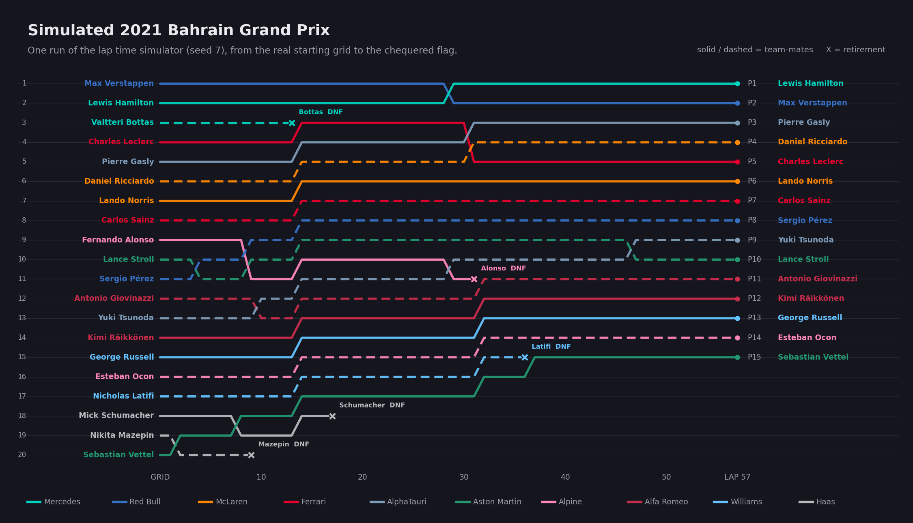

# Formula 1 Lap Time Simulator

My undergraduate thesis project (B.E. Computer Engineering, Ankara University, 2021–2022, advisor Yılmaz Ar).

All code in this repository was written by hand in 2021–2022, without any AI tools, and is published as it was written. The only change is that one unused, commented-out block in `dataFrame.py` from a later experiment was removed. This README and the figure in `docs/` were added later.

The goal was to simulate Formula 1 races lap by lap from practice and qualifying pace, as a basis for comparing pit strategies. The model is my attempt to reproduce the simulator described by f1metrics in [Building a race simulator](https://f1metrics.wordpress.com/2014/10/03/building-a-race-simulator/) (2014), rebuilt from scratch with data from the 2021 season. The project has two parts: collecting clean data from messy public sources, and a lap time simulator built on that data.



*One run of the lap time simulator for the 2021 Bahrain Grand Prix, drawn from the simulator's lap-by-lap positions.*

## Data collection

| Source | What | Code |
|---|---|---|
| FIA timing PDFs | Free practice lap times for every driver | `pdftotext.py`, `textMethods.py`, `practicePaths.py` |
| Pirelli press pages | Tyre compounds used in each race | `getTyre.py`, `tyreLinks.py` (BeautifulSoup) |
| Ergast API | Qualifying times and race lap times | `qualifyingAndRace.py` |
| FIA website | Practice, qualifying, race and pit summary PDFs for 2022 | `2022 data/*/download.py` |

The FIA PDFs are laid out for printing, not for parsing. `pdftotext.py` extracts the raw text with PyPDF2 and `textMethods.py` cleans it: it removes headers, splits the text into driver blocks, finds driver names and numbers, and recovers lap numbers, lap times and pit laps. Each driver becomes a `classDriver` object (`driver.py`).

## Simulation model

The simulator (`raceSimulate.py`) generates a lap time for each of the 20 drivers on every lap and builds the race from them:

- **Race pace.** Each driver's base lap time comes from their second practice (FP2) pace, corrected by how far they were from the fastest driver in FP2 and in qualifying.
- **Lap time variability.** Every lap adds a random term sized by the driver's own lap-to-lap variability, estimated from past races.
- **Start.** Drivers start from their real grid position, with a time gap per grid slot.
- **Retirements (DNF).** On each lap a driver can retire with a probability based on their historical retirement rate.
- **Spins.** A driver can spin with a small probability, losing 2 to 16 seconds.
- **Overtaking and DRS.** A car within one second of the car ahead gets a DRS bonus. A car that catches the car ahead but is not fast enough to pass stays behind it.
- **Safety car.** A retirement brings out a safety car for a few laps, which slows the field and closes the gaps.

The driver parameters and simulator components follow the f1metrics post above. The theoretical background (driver parameters, tyre and fuel model, pit strategy) is described in the thesis report in `report/` (Turkish).

## Example output

`simulate()` prints the classification of each race: position, driver, total race time, average lap time in milliseconds, whether the driver retired, and the number of spins.

```
1-) hamilton         53:42.108   56528   False   0
2-) max_verstappen   53:42.486   56534   False   1
3-) gasly            53:54.809   56751   False   0
4-) ricciardo        53:58.646   56818   False   0
5-) leclerc          54:4.9      56912   False   0
...
19-) bottas          11:21.268   52405   True    0
20-) mazepin          8:29.224   56580   True    0
```

The model is a thesis prototype and is not calibrated against real race times.

## Repository layout

```
f1_data/
  pdfToText/          data parsing, driver model and lap time simulator
    main.py           full pipeline: practice PDFs, qualifying, race data, simulation
    raceSimulate.py   lap-by-lap race simulation for the 2021 season
    driver.py         driver class: lap generation, DNF, spin, DRS
    pdftotext.py      FIA PDF parsing
    textMethods.py    text cleaning helpers for the PDFs
    getTyre.py        tyre data scraping from Pirelli press pages
    qualifyingAndRace.py  qualifying and race data from the Ergast API
  deneme5.py          early draft of the tyre and race model
2022 data/            download scripts for 2022 FIA timing PDFs
report/               thesis report, part 1 (Turkish)
docs/                 figure for this README
```

## Running

Python 3 with `requests`, `beautifulsoup4`, `lxml`, `PyPDF2`, `pandas` and `numpy`.

The race simulation runs on its own with the 2021 data stored in `raceSimulate.py`:

```bash
cd f1_data/pdfToText
python -c "from raceSimulate import simulate; simulate()"
```

The full pipeline in `main.py` also needs the FIA practice PDFs. The paths in `practicePaths.py` point to the Windows folder used during the project (`C:\Bitirme_Projesi\f1_data\pdf\`) and need to be changed to run it elsewhere.
